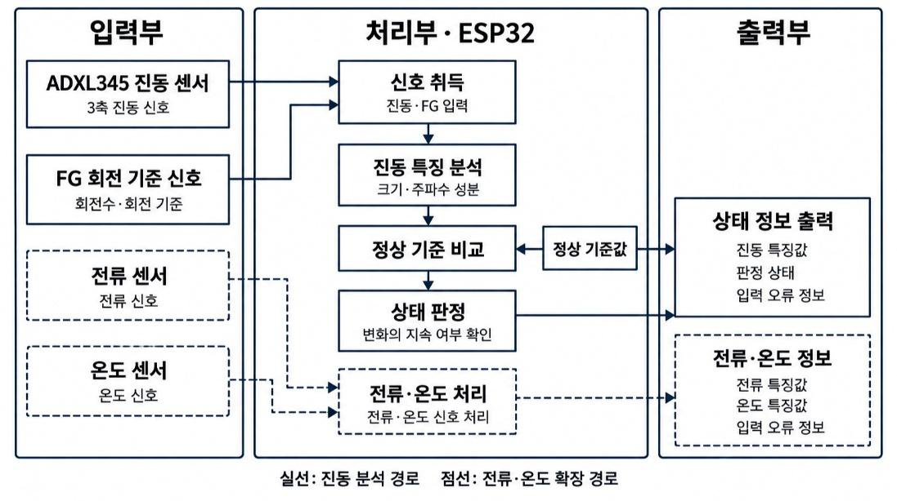
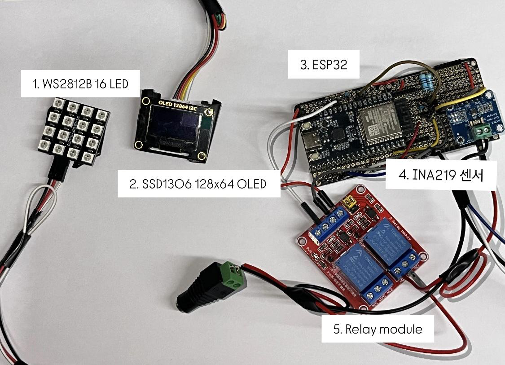

# 엣지알리미 (Edge Alimi)

소형 팬과 모터의 진동을 장치 안에서 분석해, 먼저 점검할 설비와 그 근거를 알려 주는 저비용 엣지 예지보전 모듈이다. 제5회 창의혁신 공모전 최종보고서의 알고리즘과 ESP32 펌웨어 코드를 담고 있다.



## 주요 기능

- **설비별 정상 기준과 비교한다.** 정상 운전에서 측정한 진동을 기준으로 저장하고, 이후 진동이 그 기준에서 얼마나 달라졌는지 계산한다. 설비마다 운전 조건이 달라 하나의 절대 임계값을 쓸 수 없기 때문이다.
- **회전 기준을 직접 잰다.** 팬의 FG 신호로 회전 속도를 구한다. 가장 큰 FFT 피크를 회전 주파수로 간주하지 않으므로, 다른 진동이 커져도 1×·2×·3× 위치가 유지된다.
- **두 경로로 분석한다.** 물리 근거 경로는 정상 대비 변화로 불평형과 기계적 이완의 근거를 계산하고, 학습 모델 경로는 101개 특징으로 정상·불평형·축 정렬 불량·기계적 이완을 분류한다.
- **판정할 수 없으면 그 이유를 출력한다.** 입력이 유효하지 않거나 관측 범위를 벗어난 항목은 0이나 정상으로 처리하지 않고 사유와 함께 판정 불가로 표시한다.
- **ESP32 하나에서 끝난다.** 측정부터 판정까지 장치 안에서 수행하고 결과를 JSON 한 줄로 내보낸다. 원시 파형을 외부로 보낼 필요가 없다.

## 하드웨어



진동 분석에 필요한 부품은 세 가지다.

| 부품 | 역할 | 연결 |
|---|---|---|
| ESP32 DevKitC V4 | 취득, 계산, 판정, 출력 | 시리얼 115200 baud |
| ADXL345 | 3축 가속도 측정 (400 Hz, ±4 g) | I²C 주소 `0x53`, SDA 21, SCL 22 |
| 12 V 직류 팬의 FG 출력 | 회전 속도와 위상 기준 | GPIO 25 |

사진의 LED, OLED, INA219 전류 센서, 릴레이는 표시와 보조 정보를 위한 확장 구성이다. 이 저장소의 FG 펌웨어는 센서와 FG만 읽으며 릴레이나 모터 출력을 제어하지 않는다.

FG 출력의 전압은 팬마다 다르다. 전압을 확인하기 전에 ESP32에 직접 연결하지 않는다.

## 빠른 시작

**1. 준비.** Python과 [PlatformIO](https://platformio.org/)가 필요하다. PC에서 C 계산을 비교하려면 GCC도 필요하다.

```sh
python -m pip install -r requirements.txt
```

**2. 펌웨어 빌드.**

```powershell
cd edge_module_c/esp32/edge_alimi_adxl345_fg_report
python -m platformio run
```

**3. PC에서 검사.** 장치 없이 신호 계산과 Python/C 판정 일치를 확인한다. 같은 디렉터리에서 실행한다.

```powershell
python tools/run_host_checks.py
```

**4. 장치에 올리기.** 현재 펌웨어(`postreport_v2`)는 빌드와 PC 검사까지 확인했고, 장치 업로드와 실측은 아직 하지 않았다. 올리기 전에 [ESP32 설치 준비](docs/firmware-installation.md)의 확인 순서를 따른다. 대상은 `esp32dev` 보드이며 ESP32-S2/S3/C3용이 아니다.

**5. 측정.** 부팅하면 측정 대기 상태다. 시리얼로 아래 명령을 차례로 보내 정상 기준을 등록한다.

```text
context <조건 이름>     예: fan01
ppr <회전당 펄스 수>     예: 2
learn                   정상 운전 336창을 수집해 후보 기준을 만든다
approve <후보 ID>        후보를 운영 기준으로 승인한다
start                   측정을 시작한다
```

전체 명령과 저장 실패 처리는 [정상 기준 관리](docs/baseline-lifecycle.md)에 있다.

**6. 기록 저장.** 저장소 루트에서 실행하고 포트는 실제 장치의 값으로 바꾼다.

```powershell
python edge_module_c/pi/report_serial_logger.py --port COM3 --output outputs/fg-report.jsonl
```

저장한 기록은 [보고서 첫 화면](docs/index.html)에서 불러 읽는다.

## 결과 요약

실험마다 자료와 분모가 달라 하나의 정확도로 합치지 않는다.

| 실험 | 결과 |
|---|---|
| 정상 팬 실측 | 진동으로 구한 회전수와 FG 회전수가 336행 중 333행에서 3% 이내로 일치 |
| 고장 유형 분류 (공개 자료 개발 평가) | 네 상태 정확도 93.67% |
| CWRU 베어링 잠금 시험 | 결함 486/486창 탐지, 정상 114창 확정 오경보 0건 |
| AI-Hub 벨트 느슨함 | 전체 결함 파일의 62.52% 탐지, 정상 오경보 5.80% |
| Python/C 이식 | 219회 갱신에서 판정 일치 |
| ESP32 빌드 | 정적 RAM 30.6%, Flash 24.5% |

고장 상태의 실제 설비는 측정하지 않았다. 위 탐지 결과는 공개 데이터를 재생해 얻은 것이다. 실험별 방법과 한계는 [실험 기록](docs/experiments.md)에 있다.

## 폴더 구조

```text
edge_module/
├── edge_module_c/
│   ├── esp32/edge_alimi_adxl345_fg_report/   보고서 FG 펌웨어 (여기서 빌드)
│   ├── report_physical/                      물리 근거 계산 (C)
│   ├── report_ml/                            101특징 계산과 분류 (C)
│   ├── report_cwru/                          CWRU 베어링 분류 (C)
│   ├── pi/                                   시리얼 기록 수집기
│   ├── core/, esp32/edge_alimi/              이전 V2 구현
│   └── pc_test/                              PC용 검사
├── ml/
│   ├── report_model/                         101특징 정의와 모델 개발 (Python)
│   └── *.py                                  이전 6특징 학습·평가
├── src/
│   ├── report_reference/                     보고서 C 계산의 Python 기준
│   └── feature_extraction_v2.py              V2 특징의 Python 기준
├── c/                                        초기 C99 구현과 검증기
├── docs/                                     문서와 기록 화면
└── tests/, tools/                            테스트와 검사 도구
```

`core/`, `esp32/edge_alimi/`, `c/`, `ml/*.py`는 보고서 경로와 입력·특징·평가 단위가 다른 이전 구현이다. 비교와 이력을 위해 보존한다.

## 문서

| 알고 싶은 것 | 문서 |
|---|---|
| 어떤 실험을 했고 무엇이 확인됐나 | [실험 기록](docs/experiments.md) |
| 수식과 계산 과정 | [보고서 상세 해설](docs/report-detail/README.md) |
| 결과 수치의 분자와 분모 | [결과와 검증 범위](docs/report-detail/06-results.md) |
| 구현별 입력 조건과 JSON 필드 | [C·ESP32 안내](edge_module_c/README.md) |
| 보고서 이후 무엇이 바뀌었나 | [후속 개선 기록](docs/post-report-improvements.md) |
| 보고서 인용과 원자료 위치 | [출처·코드 대응표](docs/report-detail/08-sources.md) |

보고서 장별 해설은 [1. 시스템](docs/report-detail/01-system.md), [2. 물리 근거](docs/report-detail/02-physical-evidence.md), [3. 학습 모델](docs/report-detail/03-ml-model.md), [4. 결함별 해석](docs/report-detail/04-fault-interpretation.md), [5. FG와 하드웨어](docs/report-detail/05-fg-hardware.md), [6. 결과](docs/report-detail/06-results.md), [7. 기대효과](docs/report-detail/07-effects-and-limits.md), [8. 출처](docs/report-detail/08-sources.md) 순이다.
